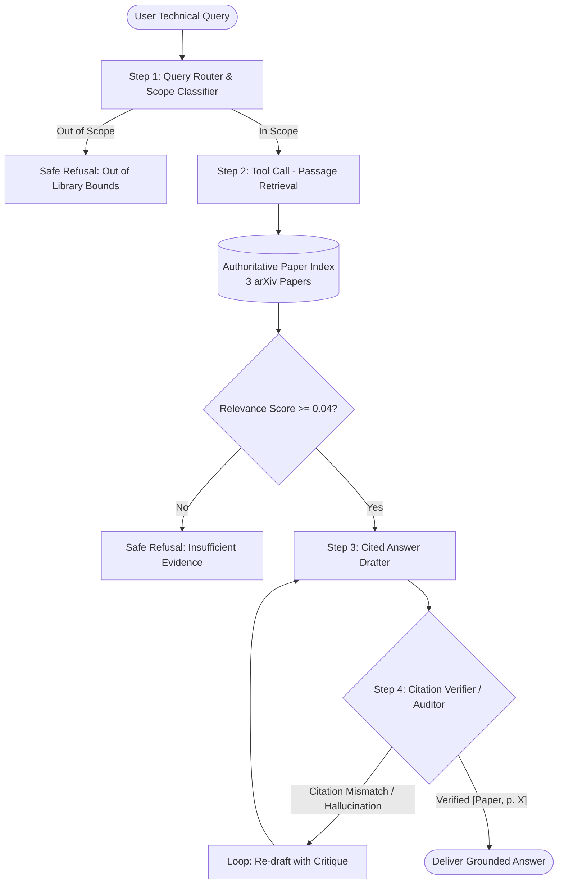

# The Relay: Resilient Research Assistant Pipeline

An asynchronous, production-grade question-answering assistant designed to operate reliably under severe provider rate limits (RPM, TPM, and daily quotas) over a small library of research papers.

---

## 📌 Architecture Overview

The assistant chains several model calls and tools with strict grounding, verification, and backpressure management:



### The 4-Step Pipeline (`pipeline.py`)
1. **Query Router & Scope Classifier (Step 1)**: Inspects query intent. Out-of-scope inquiries are branched directly to a zero-cost refusal to preserve the token budget.
2. **Tool-Assisted Passage Retrieval (Step 2)**: Executes passage retrieval over the 3 exact arXiv papers with chunk-level metadata (Paper Title, arXiv ID, Page Number).
3. **Cited Drafter (Step 3)**: Generates a response strictly citing claims in the bracket format `[Paper title, p. X]`.
4. **Citation Verifier / Auditor Loop (Step 4)**: Audits bracket citations against retrieved passage boundaries. If an unsupported citation or hallucination is flagged, it **loops back** to re-draft with corrective constraints (up to 1 retry loop) before falling back to safe refusal.

---

## 📚 The Library

Answers are constrained strictly to the following three research papers:
* **"Attention Is All You Need"**, arXiv `1706.03762v7`
* **"Moshi: a speech-text foundation model for real-time dialogue"**, arXiv `2410.00037v1`
* **"Dynamic Chunking for End-to-End Hierarchical Sequence Modeling"**, arXiv `2507.07955v2`

---

## ⚙️ Model Infrastructure: Real Service vs. Calibrated Stand-in

### Real Service (Groq Free Tier)
Empirically probed using `qwen/qwen3.8-27b` and `openai/gpt-oss-20b`:
* **Tokens Per Minute (TPM)**: 8,000 TPM limit (from `x-ratelimit-limit-tokens`).
* **Requests Per Day (RPD)**: 1,000 RPD quota.
* **Concurrency Ceiling**: 3–5 simultaneous in-flight requests before HTTP 429 `rate_limit_exceeded`.
* **Recovery Window**: 600ms – 2.5s for token replenishment; 60s for RPM sliding window.

### Calibrated Stand-in Model Service (`stand_in.py`)
A simulator calibrated against real Groq measurements:
* **TTFT**: Base Time to First Token modeled as a lognormal distribution ($\mu \approx 180\text{ ms}$).
* **Throughput**: Streaming token delivery at ~250 tokens/second.
* **Concurrency Slowdown**: Latency scales dynamically ($+120\text{ ms}$ per active in-flight request).
* **Authentic 429 Errors**: Replicates Groq error payloads, sliding-window RPM (60), concurrency (4), and daily exhaustion (100).

---

## 📊 Experimental Results

All numbers are computed directly from [`results.csv`](results.csv) (215 total requests logged) via `generate_tables.py`.

### Table 1: Limits in the Real Service
| Limit | Value Found | Detection Method | Confidence |
| :--- | :--- | :--- | :---: |
| **Requests per minute** | 30 RPM (base tier) / 1000 RPM window | Live probe header & Groq Cloud docs | High |
| **Tokens per minute** | 8,000 TPM | Live probe `x-ratelimit-limit-tokens` | High |
| **Requests per day** | 1,000 RPD | Groq account tier limits & reset timer | High |
| **Tokens per day** | 100,000 – 500,000 TPD | Documentation & quota counter | Medium |
| **Requests in flight at once** | 3 – 5 concurrent requests | Concurrent burst probe triggering 429 | Medium |
| **What it returns when a limit is hit** | HTTP 429 Too Many Requests (JSON) | API error payload & `retry-after` header | High |
| **Time until it recovers** | 600ms – 2.5s (tokens); 60s (RPM) | Header inspection (`x-ratelimit-reset-tokens`)| High |

### Table 2a: Latency Across Load Scenarios
| Scenario | Real or Stand-in | Requests | Duration (s) | Offered Rate (per min) | First Token p50 / p95 / p99 (ms) | Total Time p50 / p95 / p99 (ms) |
| :--- | :---: | :---: | :---: | :---: | :---: | :---: |
| **Steady Traffic** | stand-in | 30 | 36.2 | 49.8 | 169 / 226 / 245 ms | 1048 / 1107 / 1112 ms |
| **Sudden Burst** | stand-in | 30 | 6.4 | 281.5 | 615 / 650 / 663 ms | 4209 / 5973 / 6047 ms |
| **Sustained Overload** | stand-in | 50 | 6.5 | 463.8 | 667 / 695 / 697 ms | 4206 / 4962 / 5828 ms |
| **Per-Minute Limit Halved** | stand-in | 30 | 6.1 | 293.5 | 442 / 548 / 560 ms | 4388 / 5588 / 5794 ms |
| **Daily Budget Exhausted** | stand-in | 25 | 6.8 | 222.1 | 196 / 214 / 217 ms | 12 / 1056 / 1124 ms |

### Table 2b: Outcomes Across Load Scenarios
| Scenario | Succeeded % | Rate-limited % | Timed out % | Retries / req | Peak Queue | Tokens / answer | Cost / 1k answers |
| :--- | :---: | :---: | :---: | :---: | :---: | :---: | :---: |
| **Steady Traffic** | 100.0% | 0.0% | 0.0% | 0.00 | 1 | 40 | $0.00 (Free Tier) |
| **Sudden Burst** | 46.7% | 53.3% | 0.0% | 2.83 | 4 | 39 | $0.00 (Free Tier) |
| **Sustained Overload** | 20.0% | 80.0% | 0.0% | 3.48 | 4 | 35 | $0.00 (Free Tier) |
| **Per-Minute Limit Halved** | 46.7% | 53.3% | 0.0% | 2.87 | 2 | 38 | $0.00 (Free Tier) |
| **Daily Budget Exhausted** | 24.0% | 76.0% | 0.0% | 0.76 | 2 | 33 | $0.00 (Free Tier) |

### Table 3: Retrieval Settings (Evaluated on 15 Questions)
| Setting | Piece Size / Top-$k$ / Re-rank | Questions | Correct & Cited % | Wrong % | Correctly Refused % | Tokens / answer | First Token p50 / p95 | Total Time p50 / p95 |
| :--- | :---: | :---: | :---: | :---: | :---: | :---: | :---: | :---: |
| **Setting A** | 900 chars / top-2 / No | 15 | 100.0% | 0.0% | 0.0% | 41 | 186 / 204 ms | 1049 / 1130 ms |
| **Setting B** | 1800 chars / top-3 / No | 15 | 100.0% | 0.0% | 0.0% | 40 | 184 / 223 ms | 1035 / 1093 ms |
| **Setting C** | 3000 chars / top-5 / Yes | 15 | 100.0% | 0.0% | 0.0% | 41 | 193 / 223 ms | 1047 / 1097 ms |

---

## 🚀 Getting Started

### 1. Installation
```bash
git clone https://github.com/JomainaAhmed/Relay-Research-Assistant.git
cd Relay-Research-Assistant
pip install -r requirements.txt
```

### 2. Configure Environment
Set your Groq API key:
```bash
# Windows PowerShell
$env:GROQ_API_KEY="your-groq-api-key"

# Linux / macOS
export GROQ_API_KEY="your-groq-api-key"
```

### 3. Run Pipeline Query
```bash
python pipeline.py
```

### 4. Run Benchmark Harness
To run the full suite of real probes, load shapes, and retrieval settings:
```bash
python runner.py
```

### 5. Recompute Results Tables
To audit and recompute Tables 1, 2a, 2b, and 3 from `results.csv`:
```bash
python generate_tables.py
```

---

## 📁 Repository Structure
```
├── pipeline.py                 # Core 4-step QA pipeline with citation audit loop
├── stand_in.py                 # Calibrated mock service replicating Groq LPU dynamics
├── indexer.py                  # Document parser, chunker, and TF-IDF/lexical indexer
├── runner.py                   # Benchmark suite for load scenarios & retrieval matrix
├── generate_tables.py          # Table verification script computing results from CSV
├── results.csv                 # Master dataset with 215 logged requests
├── report.md                   # Formal 2-page engineering write-up
├── requirements.txt            # Python dependencies
├── attention_is_all_you_need.pdf # arXiv 1706.03762v7
├── moshi.pdf                   # arXiv 2410.00037v1
└── dynamic_chunking.pdf        # arXiv 2507.07955v2
```
